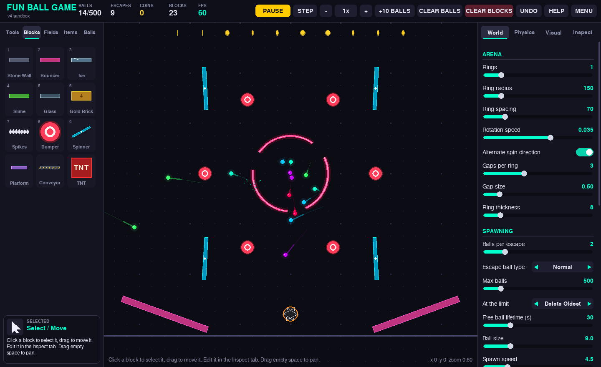

# Fun Ball Game v4 – Pygame Sandbox Edition

A physics sandbox about balls escaping spinning rings. Every time a ball gets out
through a gap, more balls spawn in the middle, so it snowballs fast. On top of that
there's a full level editor with **45 blocks, fields and items**, **15 ball types**,
**10 ready-made levels**, achievements, saving and a proper in-game UI.



## Running it

You need **Python 3.8+**.

- **Easiest:** double-click `run.py`. It installs Pygame the first time, then starts the game.
- **Terminal:**
  ```
  pip install -r requirements.txt
  python main.py
  ```
  (`python -m fun_ball_game` works too.)

Runs on Windows, macOS and Linux. Not supported on phones or tablets.

## What's in it

**Tools:** Select/Move, Spawn Balls, Grab & Throw, Eraser, Explosion, Attract, Repel

**Blocks (solid):** Stone Wall, Bouncer, Ice, Slime, Glass (shatters), Gold Brick
(breakable, gives coins), Spikes, Bumper, Spinner, Moving Platform, Conveyor, TNT
(chain reactions), Saw Blade, Flipper, One-Way Gate, Timed Door, Ball Crate

**Fields (balls pass through):** Gravity Well, Repulsor, Black Hole, Vortex, Fan Zone,
Speed Boost, Slow-Mo, Water (drag + buoyancy), Anti-Gravity, White Hole (spawns balls),
Lava (sets balls on fire), Freeze Zone

**Items:** Portal (pairs by channel), Splitter, Ball Cannon, Paint Ring, Grow Mushroom,
Shrink Ray, Coin, Mine, Laser (can rotate), Goal Hoop, Tesla Coil, Transmuter,
Gravity Flip, Turbo Ring, Teleporter, Counter

**Ball types:** Normal, Heavy, Bouncy, Ghost, Fireball, Bomb, Rainbow, Splitter,
Magnet, Tiny, Gold, Ice, Seeker, Sticky, Cluster

**Levels:** Classic (the original game), Nested Rings, Pinball, Portal Maze,
Black Holes, Ball Factory, Demolition, Chaos, Arcade, Empty Sandbox

**Settings:** up to 6 nested rings, plus rotation speed, gap count and size, gravity
strength and direction, time speed, bounciness, energy boost, ball limit and limit
action, colour schemes, trails, glow, particles, screen shake and sound. Nearly every
number in the game has a slider.

**Settings screen** (SETTINGS button or `O`): FPS limit from 30 up to unlimited, or type
your own; FPS counter; fullscreen; a custom ball limit (type any number) or no limit at
all; particle cap; detail level for huge swarms; physics substeps; autosave; sound.
These are your preferences, so loading levels or save files won't change them.

Click any block with the Select tool to open it in the **Inspect** tab. There you can
change its size, rotation and its own properties (bumper power, cannon fire rate and
ball type, portal channel, black hole strength, and so on).

## Controls

| Input | Action |
|---|---|
| Left click | Use the selected tool / place the selected block |
| Left drag with a block | Draw walls at any length and angle; drag fields to set their size; drag cannons/lasers to aim |
| Right click | Delete the block under the mouse, or hold to pull balls towards the cursor |
| Middle drag / WASD / arrows | Pan |
| Mouse wheel | Zoom (Shift+wheel rotates the block you're placing) |
| Space / N | Pause / step one frame |
| Q / E | Rotate selected or ghost block |
| Delete / Ctrl+D | Delete / duplicate selected block |
| Ctrl+Z | Undo |
| Ctrl+S / Ctrl+L | Quick save / load |
| B / C | Spawn 10 balls / clear balls |
| 1–9 | Pick a tile in the current toolbox tab |
| + / - | Simulation speed |
| G | Snap to grid |
| Tab | Hide the UI |
| F11 | Fullscreen |
| O | Settings |
| H | Help |

Saves, autosave and achievements go in the `saves/` folder next to the game.

## Project layout

```
main.py / run.py         entry points
fun_ball_game/
  game.py                app, menu, sandbox scene, editor tools, UI panels
  world.py               simulation: rings, ball physics, collisions, explosions
  blocks.py              every block / field / item (add new ones here)
  balls.py               ball types
  arena.py               spinning rings with gaps
  render.py              drawing the world
  ui.py                  pygame widget toolkit (buttons, sliders, tabs...)
  particles.py, audio.py effects and generated sound (no asset files)
  presets.py             the built-in levels
  achievements.py        achievements
  settings.py            all settings and colour themes
legacy/v3/               the original Tkinter version
```

### Adding a new block

Subclass `Block` (or `Field` / `Item`) in `blocks.py` and decorate it with
`@register`. It shows up in the toolbox, inspector and save files automatically:

```python
@register
class Trampoline(Block):
    key, name = "trampoline", "Trampoline"
    desc = "Extra bouncy."
    color = (0, 200, 120)
    restitution = 1.8
    props = [("restitution", "Bounciness", 0.5, 3.0, 0.1)]
```

## License

MIT, see [LICENSE](LICENSE).
